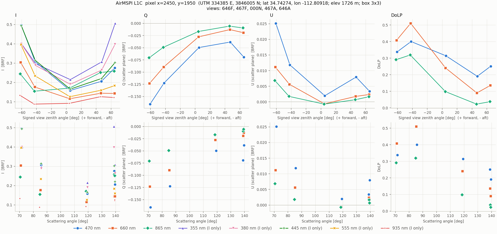
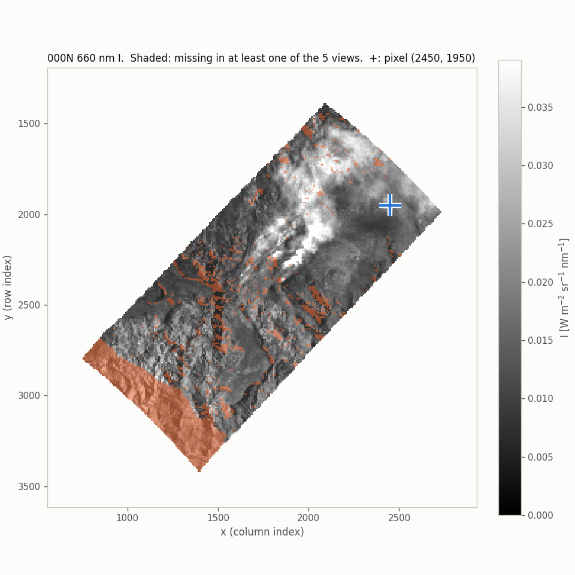

# grasp-airmspi

Tools for reading and plotting AirMSPI L1C multi-angle polarimetric data from
the FIREX-AQ campaign.

## airmspi_pixel_plot.py

Extracts the multi-angle Stokes parameters (I, Q, U) and the degree of linear
polarization (DoLP) for a single grid pixel from a set of AirMSPI L1C files,
and plots them against the viewing angle and the scattering angle. The
extracted values, together with the full sun-view geometry, can be written to
a CSV file.

### Example

Pixel x=2450, y=1950 on 2019-08-17 (3 x 3 average), created with

```bash
python airmspi_pixel_plot.py --x 2450 --y 1950 --box 3 \
    --out docs/example_pixel_x2450_y1950.png \
    --quicklook docs/example_quicklook_x2450_y1950.png
```



The quicklook shows the pixel on the nadir 660 nm image; shaded areas are
missing in at least one view.



### Data

AirMSPI L1C (GRP_TERRAIN) provides one HDF5 file per viewing angle, for
example for 2019-08-17 (target AZ-Prescott):

| View tag | Nominal view                  |
|----------|-------------------------------|
| `646F`   | 64.6 deg forward              |
| `467F`   | 46.7 deg forward              |
| `000N`   | nadir                         |
| `467A`   | 46.7 deg aft                  |
| `646A`   | 64.6 deg aft                  |

All views are mapped onto the same UTM grid (4096 x 4096 pixels at 10 m), so
one (x, y) index refers to the same ground location in every file.

Datasets used by the script (note that the group name `Data Fields` contains a
space):

| Path | Content |
|------|---------|
| `Channel_Information/Center_wavelength` | channel center wavelength (nm) |
| `Channel_Information/Solar_irradiance_at_1_AU` | F0 per channel (W m-2 nm-1) |
| `HDFEOS/GRIDS/<band>nm_band/Data Fields/I` | radiance (W m-2 sr-1 nm-1) |
| `HDFEOS/GRIDS/<band>nm_band/Data Fields/Q_scatter`, `U_scatter` | Q and U, scattering-plane frame |
| `HDFEOS/GRIDS/<band>nm_band/Data Fields/Q_meridian`, `U_meridian` | Q and U, meridian-plane frame |
| `HDFEOS/GRIDS/<band>nm_band/Data Fields/I.mask`, `Q.mask`, `U.mask` | 1 = valid, 0 = no data |
| `HDFEOS/GRIDS/<band>nm_band/Data Fields/Scattering_angle`, `View_zenith`, `View_azimuth`, `Sun_zenith`, `Sun_azimuth`, `Glint_angle`, `RDQI`, `Time_in_seconds_from_epoch` | geometry, quality and time |
| `HDFEOS/GRIDS/Ancillary/Data Fields/Latitude`, `Longitude`, `Elevation` | pixel location |
| `HDFEOS/GRIDS/XDim`, `YDim` | UTM easting and northing of the pixel centers (m) |
| `HDFEOS/ADDITIONAL/FILE_ATTRIBUTES` | `Sun distance`, `Aircraft heading (degrees)`, `Gimbal angle average (degrees)`, `Epoch (UTC)` |

I is available at 355, 380, 445, 470, 555, 660, 865 and 935 nm. Q and U, and
therefore DoLP, are available at 470, 660 and 865 nm only.

### Requirements

- Python 3
- numpy, h5py, pandas, matplotlib (3.7 or newer)
- pyproj (optional, only needed for `--latlon`)

Tested with Python 3.10.8, numpy 2.2.6, h5py 3.16.0, pandas 2.3.1,
matplotlib 3.10.3 and pyproj 3.7.1 (`~/.venv/DL`).

### Usage

```bash
source ~/.venv/DL/bin/activate

# Pixel by grid column (x) and row (y) index (all eight bands by default)
python airmspi_pixel_plot.py --x 2048 --y 2048

# 3 x 3 average, write a CSV and save a map showing the pixel location
python airmspi_pixel_plot.py --x 2450 --y 1950 --box 3 --csv pixel.csv --quicklook

# Pixel by UTM coordinates or by latitude/longitude
python airmspi_pixel_plot.py --utm 330365 3845025
python airmspi_pixel_plot.py --latlon 34.73325 -112.85287

# Polarimetric bands only, radiance units, Q/U in the meridian frame, interactive window
python airmspi_pixel_plot.py --x 2048 --y 2048 --bands pol --units radiance --frame meridian --show

# Selected bands
python airmspi_pixel_plot.py --x 2048 --y 2048 --bands 445 555 660 865

# Another flight day
python airmspi_pixel_plot.py --data-dir /path/to/AirMSPI/L1C/YYYY/MM/DD --x 2000 --y 2000
```

Exactly one of `--x/--y`, `--utm` or `--latlon` must be given.

| Option | Default | Description |
|--------|---------|-------------|
| `--x X --y Y` | | grid column and row index |
| `--utm E N` | | UTM easting and northing (m), in the zone of the files |
| `--latlon LAT LON` | | latitude and longitude (deg); requires pyproj |
| `--data-dir` | `/stor/z101/Data/FIREX-AQ/AirMSPI/L1C/2019/08/17` | directory with the L1C files |
| `--pattern` | `AirMSPI_*.hdf` | glob pattern for the L1C files |
| `--bands` | `all` | bands in nm (e.g. `445 660`), `all`, or `pol` for the polarimetric bands (470, 660, 865) |
| `--box` | `1` | odd window size; values are averaged over the valid pixels in the window |
| `--units` | `brf` | `brf` or `radiance` |
| `--frame` | `scatter` | reference frame for Q and U: `scatter` or `meridian` |
| `--out` | `airmspi_pixel_x<X>_y<Y>.png` | output figure |
| `--csv` | | write the extracted values to this CSV file |
| `--quicklook [PATH]` | `airmspi_quicklook_x<X>_y<Y>.png` | also save a map of the nadir view with the pixel marked |
| `--show` | | open interactive plot windows |

### Output

- **Figure**: 2 x 4 panels. The columns are I, Q, U and DoLP. The top row is
  plotted against the signed view zenith angle and the bottom row against the
  scattering angle. The I panels show every selected band; the Q, U and DoLP
  panels show only the polarimetric bands. The legend lists the polarimetric
  bands first and marks the others as "(I only)". Each band keeps a fixed
  color and marker. Points in the scattering-angle row are not connected,
  because neighbouring scattering angles can come from very different view
  geometries.
- **Quicklook** (`--quicklook`): 660 nm I of the nadir view with the selected
  pixel marked. Shaded areas are missing in at least one view; only unshaded
  pixels have full multi-angle coverage.
- **Table** printed to stdout and, with `--csv`, a CSV file with one row per
  (view, band):

| Column | Description |
|--------|-------------|
| `view`, `file` | view tag (e.g. `646F`) and file name |
| `band`, `wavelength_nm`, `polarized` | band label, center wavelength (nm), whether Q and U exist |
| `I`, `Q`, `U` | Stokes parameters in the selected units and frame |
| `DOLP` | degree of linear polarization |
| `n_valid_I`, `n_valid_QU` | number of valid pixels used in the box |
| `Scattering_angle`, `View_zenith`, `VZA_signed`, `View_azimuth`, `Sun_zenith`, `Sun_azimuth`, `Relative_azimuth`, `Glint_angle` | geometry (deg) |
| `RDQI` | radiometric data quality indicator |
| `time_utc` | acquisition time of the center pixel |
| `x`, `y`, `utm_x`, `utm_y`, `latitude`, `longitude`, `elevation_m` | pixel location |
| `box`, `units`, `frame` | settings used |

### Conventions

- **Grid index**: arrays are stored as `[YDim, XDim]`. `x` is the column index
  (easting increases with x) and `y` is the row index (northing decreases with
  y).
- **Normalization** (`--units brf`, default): follows the `BRF equation`
  stored in the file attributes,
  `BRF = pi * L * d^2 / (F0 * cos(SZA))`, where `d` is the `Sun distance`
  attribute and `F0` is the `Solar_irradiance_at_1_AU` of the band's I
  channel. Q and U are normalized with the same factor.
- **DoLP**: `sqrt(Q^2 + U^2) / I`, computed from the box-averaged Stokes
  parameters. With `--box 1` it equals the file's `DOLP` field. It does not
  depend on the Q/U reference frame.
- **Signed view zenith angle**: positive for forward-looking views and
  negative for aft-looking views. The sign is derived from the view azimuth
  relative to the aircraft heading, with the gimbal angle as fallback.
- **Azimuths**: `Sun_azimuth` and `View_azimuth` follow the
  photon-propagation convention. With this convention the file's
  `Scattering_angle` satisfies
  `cos(Theta) = sin(SZA) sin(VZA) cos(VAA - SAA) - cos(SZA) cos(VZA)`.
  `Relative_azimuth` is `(View_azimuth - Sun_azimuth) mod 360`.
- **Box averaging**: only pixels with mask = 1 are used, and azimuths are
  averaged as circular quantities.

### Python API

The functions can also be used directly, for example in a notebook:

```python
from airmspi_pixel_plot import list_view_files, read_pixel, plot_pixel, quicklook

files = list_view_files("/stor/z101/Data/FIREX-AQ/AirMSPI/L1C/2019/08/17")
df = read_pixel(files, ix=2450, iy=1950, box=3)  # bands=None reads all bands
fig = plot_pixel(df, out="pixel.png")
fig_map = quicklook(files, ix=2450, iy=1950)
```

`read_pixel` returns a pandas DataFrame with the same columns as the CSV; for
intensity-only bands `Q`, `U` and `DOLP` are NaN.
`plot_pixel` and `quicklook` return matplotlib Figures. `utm_to_index` and
`latlon_to_index` convert coordinates to grid indices given an open
`h5py.File`.

### Notes

- Only part of the 4096 x 4096 grid is covered by all five views, and the
  oblique views also lose pixels over steep terrain. The script warns when the
  selected pixel has no valid data in some views and plots the views that are
  available. Use `--quicklook` to choose pixels with full coverage.
- Each dataset is read only within the 512 x 512 chunk that contains the
  pixel, so a run takes a few seconds.
